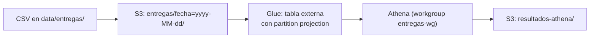

# DE-Final-Entregas: Athena con partition projection sobre S3 y Glue

Consulta de intentos de entrega de paquetes con **Amazon Athena** sobre CSV en **Amazon S3**, usando una tabla externa de **AWS Glue Data Catalog** con **partition projection**. Toda la infraestructura se define con **Terraform**. El enunciado original está en [ENUNCIADO.md](ENUNCIADO.md).



## Prerrequisitos

| Herramienta | Versión usada |
| --- | --- |
| Terraform | 1.16.2 (se exige `>= 1.6.0`) |
| AWS CLI v2 | 2.37.6 |
| Git y Git Bash (para el script de consultas) | 2.55 |

- **Credenciales AWS** en un perfil de la CLI (`~/.aws/credentials`) con permisos sobre S3, Glue y Athena. Este trabajo usa el perfil `user_cli`. **Las credenciales no se incluyen en el repositorio.**
- **Región:** `us-east-2`.
- **Restricción de nombre de bucket:** la política IAM de `user_cli` solo permite crear buckets con prefijo `la-bodega-del-pelao-`. Por eso el bucket se llama `la-bodega-del-pelao-entregas-jslm10`. Con otra cuenta o política, cambie la variable `nombre_bucket` (debe ser único a nivel global).

## Estructura

```text
.
├── README.md                      Este archivo
├── ENUNCIADO.md                   Enunciado original
├── respuestas.md                  Respuestas conceptuales
├── .gitignore  .gitattributes
├── infraestructura/               principal.tf, variables.tf, salidas.tf, .terraform.lock.hcl
├── consultas/                     SQL de la demostración
├── scripts/ejecutar_consulta.sh   Ejecuta una sentencia en Athena, descarga y registra el resultado
├── data/entregas/                 CSV suministrados (sin modificar)
├── resultados_esperados/          Referencias suministradas
├── resultados/{inicial,final}/    Resultados obtenidos en Athena
└── evidencias/                    Salidas de Terraform, outputs y registro de ejecuciones
```

## Configuración

Las variables de [infraestructura/variables.tf](infraestructura/variables.tf) tienen valores por defecto; no hace falta crear un `tfvars`.

| Variable | Por defecto | Uso |
| --- | --- | --- |
| `region` | `us-east-2` | Región del despliegue |
| `perfil` | `user_cli` | Perfil de la AWS CLI |
| `nombre_bucket` | `la-bodega-del-pelao-entregas-jslm10` | Bucket S3 |
| `nombre_base_datos` | `entregas_db` | Base de datos de Glue |
| `nombre_tabla` | `entregas` | Tabla de Glue |
| `nombre_workgroup` | `entregas-wg` | Workgroup de Athena |
| `fecha_inicial` / `fecha_final` | `2026-10-01` / `2026-10-03` | Rango proyectado (ambos incluidos) |

## 1. Despliegue

Desde la raíz del repositorio:

```bash
cd infraestructura
terraform init
terraform validate
terraform plan
terraform apply 2>&1 | tee ../evidencias/aplicacion_terraform.txt
terraform output -json > ../evidencias/outputs.json
cd ..
```

Crea 6 recursos: bucket S3 (privado, con bloqueo de acceso público y cifrado AES256), base de datos de Glue, tabla externa con partition projection y workgroup de Athena con resultados en `resultados-athena/`. No se crea ninguna partición individual.

La tabla declara `id_envio`, `ciudad`, `transportadora` y `estado` como `string`, `duracion_minutos` como `int`, y `fecha` como clave de partición `string`. Lee CSV con `LazySimpleSerDe` (separador coma) y omite el encabezado con `skip.header.line.count = 1`. La proyección es de tipo `date`, formato `yyyy-MM-dd`, rango `2026-10-01,2026-10-03`, intervalo 1 día, y la plantilla `s3://<bucket>/entregas/fecha=${fecha}/` termina en `/`.

> `evidencias/aplicacion_terraform.txt` tiene el ID de la cuenta AWS reemplazado por `<ACCOUNT_ID>` (`sed -i -E 's/[0-9]{12}/<ACCOUNT_ID>/g'`). Es la única edición del archivo.

## 2. Demostración inicial: días 1 y 2

Carga de **solo** dos archivos, uno por comando (sin `--recursive`):

```bash
BUCKET=$(terraform -chdir=infraestructura output -raw bucket)
aws s3 cp "data/entregas/fecha=2026-10-01/entregas.csv" "s3://$BUCKET/entregas/fecha=2026-10-01/entregas.csv" --profile user_cli
aws s3 cp "data/entregas/fecha=2026-10-02/entregas.csv" "s3://$BUCKET/entregas/fecha=2026-10-02/entregas.csv" --profile user_cli
```

Consultas (cada una registra su ejecución en `evidencias/ejecuciones_athena.csv`):

```bash
bash scripts/ejecutar_consulta.sh inicial consultas/verificacion_inicial.sql              resultados/inicial/verificacion_total.csv
bash scripts/ejecutar_consulta.sh inicial consultas/intentos_por_fecha_estado.sql         resultados/inicial/intentos_por_fecha_estado.csv
bash scripts/ejecutar_consulta.sh inicial consultas/porcentaje_exito_por_fecha_ciudad.sql  resultados/inicial/porcentaje_exito_por_fecha_ciudad.csv
bash scripts/ejecutar_consulta.sh inicial consultas/duracion_promedio_2026-10-02.sql       resultados/inicial/duracion_promedio_2026-10-02.csv
```

Comparación con las referencias (sin salida de error = idénticos byte a byte):

```bash
cmp resultados/inicial/intentos_por_fecha_estado.csv        resultados_esperados/intentos_por_fecha_estado_inicial.csv
cmp resultados/inicial/porcentaje_exito_por_fecha_ciudad.csv resultados_esperados/porcentaje_exito_por_fecha_ciudad_inicial.csv
cmp resultados/inicial/duracion_promedio_2026-10-02.csv      resultados_esperados/duracion_promedio_2026-10-02.csv
```

Resultado esperado: `verificacion_total.csv` contiene `12`.

## 3. Nueva fecha: día 3

Sin cambiar la infraestructura ni la tabla, y sin crawlers, `MSCK REPAIR TABLE` ni `ALTER TABLE ADD PARTITION`: solo subir el archivo y consultar.

```bash
aws s3 cp "data/entregas/fecha=2026-10-03/entregas.csv" "s3://$BUCKET/entregas/fecha=2026-10-03/entregas.csv" --profile user_cli

bash scripts/ejecutar_consulta.sh final consultas/verificacion_tercer_dia.sql resultados/final/verificacion_tercer_dia.csv 1
bash scripts/ejecutar_consulta.sh final consultas/verificacion_tercer_dia.sql resultados/final/verificacion_total_tabla.csv 2
bash scripts/ejecutar_consulta.sh final consultas/verificacion_tercer_dia.sql resultados/final/verificacion_conteos_tercer_dia.csv 3
bash scripts/ejecutar_consulta.sh final consultas/intentos_por_fecha_estado.sql        resultados/final/intentos_por_fecha_estado.csv
bash scripts/ejecutar_consulta.sh final consultas/porcentaje_exito_por_fecha_ciudad.sql resultados/final/porcentaje_exito_por_fecha_ciudad.csv

cmp resultados/final/intentos_por_fecha_estado.csv         resultados_esperados/intentos_por_fecha_estado_final.csv
cmp resultados/final/porcentaje_exito_por_fecha_ciudad.csv resultados_esperados/porcentaje_exito_por_fecha_ciudad_final.csv
```

`verificacion_tercer_dia.sql` tiene tres sentencias (el último argumento del script es el número de sentencia): los seis registros del 2026-10-03, el total de la tabla (**18**) y los conteos por estado de esa fecha. Las consultas agregadas no tienen filtro de fechas: la proyección ya cubre los tres días, así que no fue necesario modificar el SQL.

[evidencias/verificaciones_aws.txt](evidencias/verificaciones_aws.txt) guarda las comprobaciones posteriores a la carga: Glue con **0 particiones registradas**, tabla con `UpdateTime` igual a `CreateTime` (no se modificó) y `terraform plan` sin cambios.

## Evidencias

| Archivo | Contenido |
| --- | --- |
| `evidencias/aplicacion_terraform.txt` | Salida de `terraform apply` |
| `evidencias/outputs.json` | Outputs: bucket, base de datos, tabla, workgroup, prefijos y región |
| `evidencias/ejecuciones_athena.csv` | `etapa, archivo_sql, id_ejecucion, archivo_resultado` de cada consulta (4 `inicial`, 5 `final`) |
| `evidencias/verificaciones_aws.txt` | Estado de S3, Glue y Terraform tras cargar el día 3 |
| `evidencias/eliminacion_terraform.txt` | Salida de `terraform destroy` |

## Notas para reproducir

- **Finales de línea.** Los CSV deben subirse con LF (313 bytes los días 1 y 2, 323 el día 3). Git for Windows con `core.autocrlf=true` los baja con CRLF; por eso el repo incluye [.gitattributes](.gitattributes) (`*.csv text eol=lf`). Los objetos en S3 se verificaron con `cmp` contra los archivos originales.
- **Comillas en los resultados.** Athena escribe sus CSV con todos los valores entre comillas. `scripts/ejecutar_consulta.sh` las quita para poder comparar con `resultados_esperados/`; los valores no cambian. El archivo original con comillas permanece en `s3://<bucket>/resultados-athena/<id_ejecucion>.csv`.
- **Enmascarado del ID de cuenta.** En `aplicacion_terraform.txt` y `eliminacion_terraform.txt` el ID de la cuenta AWS se reemplazó por `<ACCOUNT_ID>`. Como el `sed` busca cualquier secuencia de 12 dígitos, en `eliminacion_terraform.txt` (línea 187) también tapó 12 dígitos dentro de un identificador hexadecimal que no era el ID de cuenta; esa única ocurrencia quedó como `<12_DIGITOS_ENMASCARADOS>`. No hay otra edición en los logs.
- **Perfil y región.** El script usa `AWS_PROFILE=user_cli` y `AWS_DEFAULT_REGION=us-east-2`; se pueden sobrescribir con variables de entorno.

## 4. Limpieza

Primero se guardan las evidencias (sección anterior). Después:

```bash
BUCKET=$(terraform -chdir=infraestructura output -raw bucket)
aws s3 rm "s3://$BUCKET" --recursive --profile user_cli      # datos y resultados de Athena
cd infraestructura
terraform destroy 2>&1 | tee ../evidencias/eliminacion_terraform.txt
sed -i -E 's/[0-9]{12}/<ACCOUNT_ID>/g' ../evidencias/eliminacion_terraform.txt
```

Verificación: `terraform state list` sin salida, `aws s3api head-bucket --bucket "$BUCKET"` con error 404, y `aws glue get-database --name entregas_db` / `aws athena get-work-group --work-group entregas-wg` con error de no encontrado.

## Respuestas

Las respuestas conceptuales están en [respuestas.md](respuestas.md).
